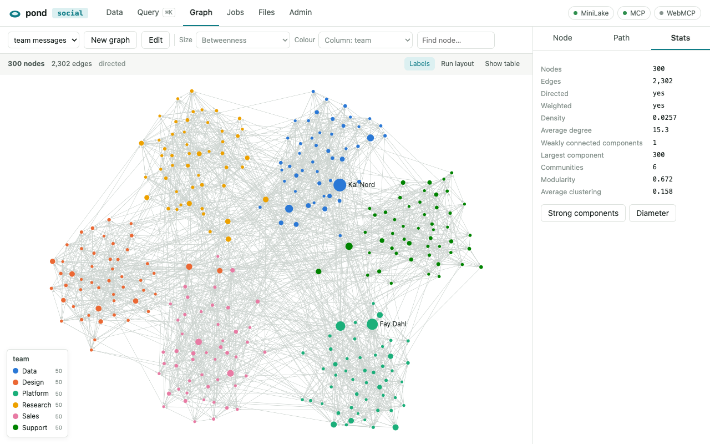
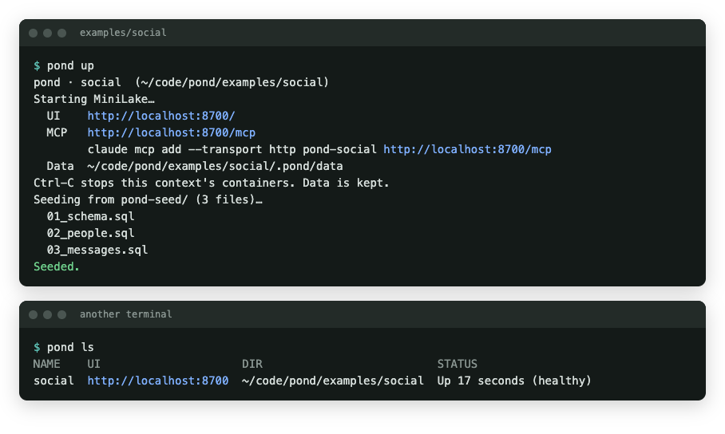
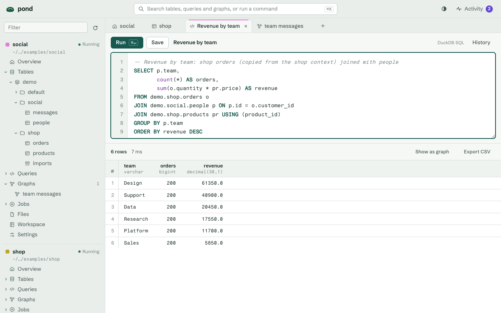

# pond

A local data lake per directory. Run `pond` in a folder and you get a [MiniLake](https://dmux.github.io/minilake) (a local Databricks emulator) for that folder, a web UI to work with it, and **MCP** and **WebMCP** endpoints so agents can work with it too.

Use it to try out Databricks-style catalogs, Delta tables, SQL and PySpark jobs on your own machine, with each project's data kept separate and next to the project.

<picture>
  <source media="(prefers-color-scheme: dark)" srcset="docs/images/graph-dark.png">
  
</picture>

## Requirements

- Go 1.25 or later, if you build pond yourself.
- Docker, through Docker Desktop, OrbStack or colima. Pond runs MiniLake in a container.

Pond is a single binary with the UI embedded. It has no other dependencies.

## Install

With [Homebrew](https://brew.sh) on macOS:

```sh
brew install --cask asabla/tap/pond
```

Or with Go:

```sh
go install github.com/asabla/pond@latest   # installs `pond` into $(go env GOPATH)/bin
```

Prebuilt binaries for macOS and Linux are on the [releases page](https://github.com/asabla/pond/releases).

Or build from a checkout:

```sh
git clone https://github.com/asabla/pond && cd pond
go build -o pond .
```

## Quick start

```sh
cd ~/code/my-project
pond
```

```
pond · my-project  (/Users/me/code/my-project)
Starting MiniLake…
  UI    http://localhost:8700/
  MCP   http://localhost:8700/mcp
        claude mcp add --transport http pond-my-project http://localhost:8700/mcp
  Data  /Users/me/code/my-project/.pond/data
Ctrl-C stops this context's containers. Data is kept.
```

Open the UI URL in a browser, or run the printed `claude mcp add` command to give an agent access. Press Ctrl-C to stop. Your data stays in `.pond/` for the next run.

## Usage

```sh
pond [up] [DIR] [flags]          # start the context for DIR (default: current directory)
pond ls                          # list running contexts across directories
pond down [DIR]                  # stop a context and remove its containers (keeps data)
pond open [DIR]                  # open a running context's UI in the browser
pond logs [DIR] [-f] [--tail N]  # show the context's MiniLake logs
pond seed [DIR]                  # run the seed scripts again (see Seed data)
pond reset [DIR] [--yes]         # delete the lake's data, then seed it again
pond export [DIR] [-o FILE]      # snapshot a stopped context's data to a .tar.gz
pond import FILE [DIR] [--yes]   # replace a stopped context's data with a snapshot
pond version                     # print the version
```

Flags for `up` (each flag can also be set with an environment variable):

| Flag | Environment variable | Default | Description |
| --- | --- | --- | --- |
| `--port N` | `POND_PORT` | the context's last port, else 8700, else the next free one | UI port. With an explicit port, pond fails instead of picking another one. |
| `--host HOST` | `POND_HOST` | `127.0.0.1` | Address the UI binds to. See [Sharing a context](#sharing-a-context). |
| `--image IMAGE` | `POND_MINILAKE_IMAGE` | `ghcr.io/dmux/minilake:1.9.0` | MiniLake container image. |
| `--minilake URL` | `MINILAKE_URL` | none | Use a MiniLake you run yourself instead of starting a container. |
| `--open` | none | off | Open the UI in a browser. |

Set `POND_VERBOSE=1` to log every HTTP request pond serves.

`reset` and `import` ask you to type the context's name before deleting data, unless you pass `--yes`.

The directory has to be visible to Docker. colima and Docker Desktop share your home directory by default. If Docker can't see the path, pond refuses to start and explains why.

## Contexts

Each directory is its own **context**, so data from different projects never mixes and you always know which one you're in:

- **Data** lives in `<dir>/.pond/`, which contains its own `.gitignore` so git ignores it. Catalogs, Delta files, volumes, jobs, queries and secrets survive restarts.
- **One MiniLake container** runs per context, named `pond-<name>-<hash>-minilake`, on its own Docker network, `pond-<name>-<hash>`. MiniLake's Spark job containers join that network, so they are scoped to the context and can call back into its MiniLake.
- **The URL is stable.** The context remembers its UI port, so an MCP registration keeps pointing at the same context. If another program holds that port, pond uses a free one for that run and tells you which MCP registrations won't reach it.
- **One pond per context.** The running pond holds a lock on `.pond/lock`, so a second `pond` in the same directory points you at the first one instead of starting another lake.
- **The context name is visible everywhere:** in the terminal banner, the UI header, the browser tab title, the suggested MCP server name and WebMCP's `get_view` tool.

Ctrl-C stops the context gracefully (MiniLake snapshots its state), then removes every container on the context's network and the network itself. If pond was killed, the next `pond` in that directory cleans up the leftovers first.

## Seed data

A project can describe its sample data instead of committing it. Put `.sql` and `.py` files in `pond-seed/` in the project directory. The first time a context starts with an empty lake, pond runs them in filename order:

```
my-project/
  pond-seed/
    01_catalog.sql
    02_generate.py
```

```sql
-- pond-seed/01_catalog.sql
CREATE CATALOG IF NOT EXISTS shop;
CREATE SCHEMA IF NOT EXISTS shop.raw;
CREATE OR REPLACE TABLE shop.raw.customers AS
  SELECT i AS id, 'customer_' || i AS name FROM range(1000) t(i);
```

- **SQL files** can hold several statements, separated by semicolons, in MiniLake's DuckDB dialect. Pond runs `CREATE CATALOG [IF NOT EXISTS] name` and `CREATE SCHEMA [IF NOT EXISTS] catalog.schema` through Unity Catalog itself: DuckDB has no `CREATE CATALOG`, and a schema made in SQL works but doesn't appear in the catalog tree. The Query tab does the same.
- **Python files** run as one-off jobs, so they can use PySpark. They are saved in the workspace under `/Shared/pond/seed/`.

Seeding stops at the first failure and prints the error, including the end of a failed Python run's output. A Python script that runs for more than an hour is stopped. Fix the script, then run `pond reset` to start from an empty lake, or `pond seed` to run all the scripts again. Scripts that use `IF NOT EXISTS` or `CREATE OR REPLACE` can safely run more than once. If seeding didn't finish, the next `pond` start says so, because the lake may be half seeded.

### Example

[`examples/social`](examples/social/pond-seed) generates a small company messaging network: 300 people in six teams (`demo.social.people`) and 2,302 sender → recipient edges weighted by message count (`demo.social.messages`). Most messages stay within a team, and a few connectors message across teams. To explore it:

```sh
pond examples/social
```



In the **Data** tab, open `demo.social.messages`, choose **Open as graph**, and pick `demo.social.people` as the node table with `name` as the label.

## Snapshots

`pond export` writes a stopped context's lake data to a `.tar.gz` file, and `pond import` loads one into a stopped context, replacing its data. Use them to back up a lake or hand it to someone else. Snapshots leave out MiniLake's download caches. If a snapshot is damaged or contains paths outside the lake, `import` refuses it and leaves the existing data unchanged.

## Sharing a context

By default, pond listens on `127.0.0.1`, so only your machine can reach it. To let others on your network use a context, start it with a host that other machines can reach:

```sh
pond --host 0.0.0.0
```

Pond prints a warning and the URLs others can use. Anyone who can reach the port can read and change the lake and run code in it, because MiniLake has no authentication. Pond accepts requests addressed to this machine's hostname and IP addresses, and refuses other names, which keeps DNS-rebinding attacks out.

## UI

| Section | What you can do |
| --- | --- |
| **Data** | Browse catalogs → schemas → tables and volumes. Create and drop catalogs, schemas and volumes; drop tables. Import CSV, TSV, JSON, JSON Lines or Parquet into a table by dropping a file anywhere (create, replace or append). Table pages show columns, a preview and storage details. |
| **Query** | SQL editor (⌘↵ runs, ⌘S saves, ⌘K jumps here), result grid, CSV export, saved queries and the lake's query history. MiniLake runs the DuckDB dialect, not Spark SQL. |
| **Graph** | Explore relationships in your tables as an interactive network. See [Graphs](#graphs). |
| **Jobs** | Write and run Python/PySpark scripts once, or save them as jobs and run them again. Runs show status, duration and output. |
| **Files** | Browse the lake's files (DBFS and `/Volumes`): upload by drag and drop, create folders, download, delete, preview data files as tables, query a file in place or turn it into a table. Browse and edit workspace scripts, and run them. |
| **Admin** | Context details, SQL warehouses, secret scopes and keys, MiniLake's services, and resetting this context's lake. |

<picture>
  <source media="(prefers-color-scheme: dark)" srcset="docs/images/query-dark.png">
  
</picture>

Destructive actions (dropping, deleting folders, resetting) ask for confirmation. When a lot is at stake, you confirm by typing the object's name. If MiniLake stops responding, the page says so and reconnects by itself.

### Known limitations

These come from MiniLake 1.9.0:

- Cancelling a run doesn't stop the script.
- Run output appears only when the run finishes.

## Graphs

The **Graph** tab draws a network from your tables and analyses it. A graph is defined by SQL:

- **Edges:** a query whose first two columns are the source and target node ids. A column named `weight` weights edges. Other columns become edge attributes.
- **Nodes (optional):** a query whose first column is the node id. A column named `label` names nodes. Other columns become attributes you can colour by.

Create one with **New graph** (pick an edge table and map its columns), with **Open as graph** on a table page, or with **Show as graph** on any Query result whose first two columns are source and target. Save a graph to reopen it later. Saved graphs are stored in the lake under `/pond/graphs/`.

What you can do with a graph:

- **Size nodes** by degree, in-degree, out-degree, PageRank, betweenness, closeness, eigenvector centrality, HITS hub and authority scores, or clustering coefficient.
- **Colour nodes** by Louvain community, connected component, strongly connected component, or any node column. The eight largest groups get their own colour, and the rest share "Other".
- **Find shortest paths** between two nodes. Weights count as distances when the graph has a weight column.
- **Inspect** a node's attributes, metrics and neighbours, and see graph statistics: density, average degree, components, communities with modularity, average clustering and diameter.
- **Switch to the table view** to see every node with its metrics, export them as CSV, or save them as a lake table to join in SQL.

Graphs with up to 30,000 edges load in full, and every metric is exact. Bigger graphs open on their 20 best-connected nodes and those nodes' neighbours. Double-click a node to load its neighbours. Metrics then describe the loaded nodes, while shortest paths search the whole graph in SQL, up to 20 hops and ignoring weights.

The graph libraries ([sigma.js](https://www.sigmajs.org) and [graphology](https://graphology.github.io)) ship inside pond and load the first time you open the tab, so graphs work offline. Their licences are in `web/static/vendor/LICENSES.md`.

## Agents

### MCP (Claude Code, Claude Desktop, Codex and other MCP clients)

`/mcp` is the context's MiniLake MCP server, with its tools, resources and prompts, forwarded through pond. Register one server per context:

```sh
claude mcp add --transport http pond-my-project http://localhost:8700/mcp
```

### WebMCP (agents in the browser)

The page registers its actions as tools on `navigator.modelContext` ([spec](https://webmachinelearning.github.io/webmcp/)). Tools act through the UI, so you see what the agent does, and every call is listed under **Agent** in the header.

| Area | Tools |
| --- | --- |
| Orientation | `get_view` |
| Data | `list_catalogs`, `list_schemas`, `list_tables`, `describe_table`, `open_table`, `create_catalog`, `create_schema`, `create_volume`, `import_data`, `create_table_from_file`, `drop_object` |
| Query | `run_sql`, `draft_sql`, `save_query`, `list_saved_queries`, `query_history` |
| Jobs | `list_jobs`, `list_runs`, `get_run`, `run_script`, `create_job`, `run_job` |
| Graph | `list_graphs`, `open_graph`, `save_graph`, `graph_metrics`, `graph_stats`, `shortest_path`, `graph_neighbors` |
| Files | `list_files`, `read_file`, `write_file`, `delete_path`, `list_workspace`, `read_workspace_file`, `write_workspace_file` |
| Admin | `list_warehouses`, `list_secrets`, `put_secret`, `reset_lake` |

`drop_object`, `delete_path` and `reset_lake` open the same confirmation dialog a person gets, through `requestUserInteraction` when the browser provides it. If the user cancels, the tool fails with "The user declined." Secret values are never returned or shown in the activity log.

In browsers without native WebMCP, load a WebMCP polyfill (for example MCP-B's `@mcp-b/global`) or call the same tools from `window.pond.tools`.

## Development

```sh
go run . ~/some/dir          # run from a checkout
go test ./...                # Go tests use a fake docker CLI and fake MiniLake; no daemon needed
node --test web/test/        # UI tests only (go test runs these too when node is installed)
golangci-lint run            # Go linters, configured in .golangci.yml
deno lint                    # UI linter, configured in deno.json
deno check web/static/graph.js web/static/lake.js web/static/dom.js   # type-checks the shared UI modules
go build -ldflags "-X main.version=$(git describe --tags --always)" -o pond .
```

Pushing a `v*` tag runs the tests, then [GoReleaser](https://goreleaser.com) publishes binaries to GitHub Releases and updates the Homebrew cask in [asabla/homebrew-tap](https://github.com/asabla/homebrew-tap). CI runs the same tests, plus the linters and `govulncheck`, on every push and pull request.

The UI is embedded in the binary, so UI changes need a rebuild (`go build`) or a fresh `go run`.

```
main.go                      CLI: up, ls, down, open, logs, seed, reset, export, import, version
internal/pondctx/            per-directory contexts: containers, network, lock, .pond/ data and snapshots
internal/server/             embedded UI, MiniLake proxy (/api, /_minilake, /mcp), /pond/config
internal/lake/               MiniLake calls pond makes itself: warehouse, SQL, catalogs, runs, reset
internal/seed/               runs pond-seed/ scripts
web/static/                  UI: plain HTML/CSS/JS modules, no build step
  lake.js                    MiniLake API client, shared by UI and WebMCP
  graph.js                   graph definitions, SQL builders and metrics, shared by UI and WebMCP
  app.js                     shell: routing, catalog tree, status, agent activity
  views/                     data, query, graph, jobs, files, admin
  vendor/                    sigma.js and graphology browser builds, with their licences
  webmcp.js                  WebMCP tool definitions
web/test/                    UI unit tests (node --test, no dependencies)
examples/social/             seed scripts for a generated example network
docs/images/                 README screenshots, taken from the example
```

## License

[MIT](LICENSE)
